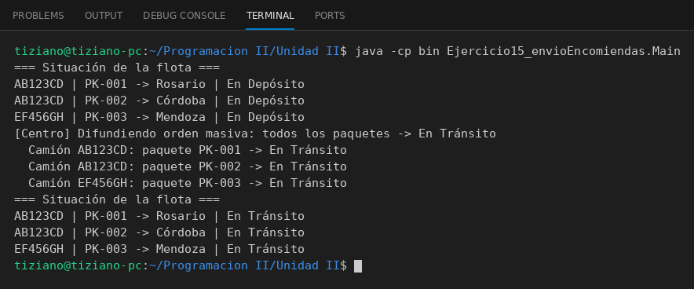

# CentroLogistico

Programación II - Unidad 2 - Ejercicio 15

## Consigna
Un centro logístico difunde órdenes de cambio de estado a los camiones de reparto.

## Lógica
- `Paquete` (código, destino, estado inicial "En Depósito") y `CamionDeReparto` (patente y lista de paquetes).
- `CamionDeReparto.actualizarEstadoPaquete(codigo, estado)`: valida el estado (En Depósito, En Tránsito, Entregado) y actualiza el paquete.
- `CentroLogistico.difundirEstado(estado)`: recorre todos los camiones enviándoles la orden para cada paquete.
- `Main`: dos camiones con tres paquetes, un mensaje masivo y verificación por consola.

## Ejecución

